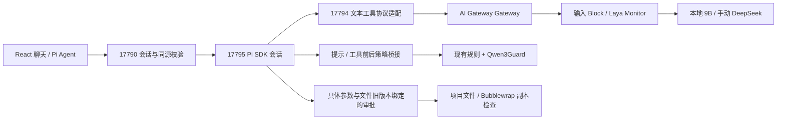

# Monorepo 与 Pi Agent

## 统一 Agent 入口（2026-10-22）

产品仅保留 Agent，后台按能力和项目上下文区分直接回答与 Pi 工具执行。无项目可聊天，绑定项目不自动授权。新快照独立记录 execution/access，旧 ask 快照继续兼容；项目直接回答的存储校验项目归属和会话绑定。见 [unified-agent.md](unified-agent.md)。决策模型、AI Gateway 桥接与工具协议未更换。

## 决策与回答分离

共享DecisionEngine契约限定三个本地引擎。界面提交decision_engine，Node绑定AgentRun，Python准入判决一次并锁定lease。普通聊天共用适配器，规则保护优先。引擎只返回分类，不提供任意地址、模型标识或权限。

Laya保留CPU路径，两款后摩服务仅回环、按需加载，设备gate协调任务。服务控制限定固定unit。回答仍通过AI Gateway Block及Monitor，调用范围、工具审批和输出协议分别验证。

分类对比页现支持原生分类器和小型生成模型。它只消费私有测量JSON，不改生产路由包、Laya服务、回答模型池或工具执行策略。不同精度、输出协议、缺失概率和视觉范围在数据契约中分别标记；不存在因测试结果自动切换Auto的路径。

2026-10-21 新增独立 CPU 分类实验服务和 React `#decision-routing` 对比页。GLiNER 不接入生产 Auto，模型及依赖放在独立私有环境，只监听回环 17786；看板读取独立结果 JSON。线上路由仍走原 Laya，服务启动或停止均不影响现有模型选择。详见 [分类模型实验](decision-models.md)。

Orion Lab 自研代码采用 MIT 许可，包括本项目的网关 API 适配层。AI Gateway 是独立闭源组件，由部署方单独安装。Pi SDK 和模型为独立依赖，按各自许可管理。

```text
apps/
  console/          React 看板与统一聊天/Pi工作区（同一 Vite 多入口应用）
  agent-server/     Pi 会话、任务 API、审批与私有事件存储
packages/
  contracts/        浏览器与 Node 的共享类型、运行时请求校验
  ui/               本项目的 React / Radix 基础封装和主题 token
  agent-runtime/    显式装配 Pi SDK，关闭自动工具、Skills、扩展与凭据发现
  gateway-adapter/ 审核桥接客户端、原生 Pi 来源能力检查
  model-router/     Agent任务模型与scope准入；Python本地Laya判决
  tool-runner/      路径限制、内容限制、写入校验和 Bubblewrap 检查
services/o6n-bridge/ 原聊天、模型代理和安全策略；Agent 模型兼容层
deploy/o6n/         user systemd unit、空配置模板、演示项目
```

两个公开入口保持看板 17780、聊天 17790。新建的 17794、17795 仅监听回环地址，页面通过原聊天服务的设备会话与同源检查访问 `/api/agent/*`。内部随机凭据在设备私有状态目录生成，不进入浏览器。



## 两种工具模式

Ask 默认只读：仅注册 `list_files`、`read_file`、`search_files`。Agent 模式额外注册 `write_file`、`run_check`。模型只能请求工具，不能赋予自己权限。写入需审批，审批绑定 run、工具、参数与原文件 SHA256，90 秒有效并只消费一次。原文件发生变化会拒绝应用。写入前保存私有恢复备份。

检查仅支持固定的 `python_compile`、`python_tests`。服务端将最多 1 MiB 的过滤文件复制到临时目录，使用 Bubblewrap 隔离网络、PID、IPC、文件系统，清空环境与 capability。不挂载用户 home、真实项目、Docker socket 或凭据。最长 30 秒、512 MiB 地址空间、20 秒 CPU、64 KiB 输出。取消会杀进程组，随后清理副本；副本内容不回写项目。它是 Linux 进程隔离，不是虚拟机。

任务仅开放独立 demo 项目；暂不开放任意目录、自由 shell、依赖安装、部署、Git push 或模型自动切换。任务上限 5 分钟、8 次工具尝试、单并发。整个 Agent 任务占用原聊天的设备门锁，包括等待审批；结束或取消后释放，模型请求未退出前不提前释放。

## AI Gateway 原生 Hooks 与策略桥接的区别

当前 AI Gateway 原生 Hook API 只接受 `codex`、`claude_code`，来源在写入、查询、签名租约和统计中均有校验。遵循用户“不修改 AI Gateway 源码”的约束，本项目不会冒用来源，也不写它的数据库。

当前可用的是本项目的 **Pi 策略桥接记录**：`UserPromptSubmit`、`PreToolUse`、`PostToolUse` 调用当前输入规则与 Qwen3Guard，拒绝时停止；记录在 Pi 页面及私有 JSONL。模型请求另行经过 AI Gateway 的真实输入 Block 与 Laya Monitor，并在原请求日志中有 Gateway request ID。桥接记录不等同于 AI Gateway Agent Hooks 页的原生记录。2026-10-20用户确认继续保留桥接、不改AI Gateway，因此原生Pi来源支持延期；包内保留来源能力校验函数，当前没有开放原生模式。

`PostToolUse` 在工具完成后执行，不能撤销写入；只控制结果是否回传模型及页面。文件恢复需要用私有备份人工执行。流式输出审核未启用，不宣称输出内容已经全面审核。

## 模型工具协议

当前已发布模型目录没有声明原生 tools 能力，直接传 `tools` 会被 AI Gateway 拒绝为 `capability_mismatch`。Agent 专用适配层把显式工具定义和历史转换为文本。协议v2.2分别表示tool动作、text最终回答、json业务data；旧tool/arguments及answer继续严格兼容。9B在既有Gateway审核之后由本项目适配器附加一次性Schema约束，不改AI Gateway。工具格式、参数、白名单与任务模式通过后才转为Pi事件，路径、审批和执行边界由Pi再次检查。明确最终回答的格式错误最多纠正一次，纠正轮禁止工具。详见[工具协议](agent-protocol.md)。

这属于结构化文本工具兼容，不证明上游已经支持原生 function calling。Agent 对工具JSON先缓冲完整验证，对answer字符串增量解码；原普通聊天保持流式。Agent Auto仅本地时使用9B，允许云端时由Laya在9B／DeepSeek间判决，每条任务一次、工具循环内锁模。范围绑定服务器lease并逐轮检查，云端每轮受日限额约束。见[动态选模](agent-routing.md)。27B 保留原聊天的手动切换方式。

## 数据与开源边界

2026-10-22起，参赛构建不再注入或复制模型测试数据。17780只展示资源监控，旧评测hash规范化为`#resources`；17790保留聊天模型及Auto决策选择。历史测试统一归档于项目外层“模型测试归档”，飞书报告提供完整附件；默认`examples/`仍为空示例。构建输出、证据、日志、账号、配置凭据、模型权重、SQLite 和 JSONL 不纳入 Git。旧浏览器 storage key 保持原值，新统一索引幂等读取旧历史。Pi JSONL 只记录审核通过的任务内容、审批与结果，设备私有目录权限 0700、文件 0600；未经审核的提示不持久化。历史任务重启后可查看，未完成任务标为取消，不自动恢复执行。

执行检查必须确认当前 cgroup 的 `pids.max` 为有限值且不超过 128；user unit 设置 `TasksMax=128`、`MemoryMax=1G`。不使用针对整个运行用户的低 `RLIMIT_NPROC`，避免把既有模型进程计入而导致 namespace 创建失败。


聊天与 Pi 使用同一个 React 工作区；Conversation / Turn / Run、完成上下文与跨执行方式接续见 [unified-workspace.md](unified-workspace.md)。旧 `#agent` 只预选模式，不挂载第二个 AppShell。

## Pi回答事件流与用户界面

新增同源GET `/api/agent/runs/:id/events`：Node仅在内部令牌与会话owner校验后发送快照、持久化后的entry及心跳，Python沿用设备会话代理并逐行flush。前端按事件序号单调合并，不用旧轮询覆盖新流。正常消息只展示回答；原审核/工具/标识仍在详情。原端口、状态目录、单并发、审批和策略桥接保持。

模型侧通过AI Gateway真实SSE增量解码文本最终回答字段（content，兼容旧answer）；工具JSON及业务JSON完整校验后才执行或展示。Pi SDK text_delta经累计敏感模式检查及32字符边界缓冲后发布answer_delta，message_end发布带同一消息编号的权威answer。完成正文替换预览，失败片段不保存为已完成上下文。客户端停止后保持在途模型租约直到上游排空。

`packages/harness-ui`直接包含用户授权MIT再分发的Harness PromptInput和必要UI源码；不再依赖Ant Design X替代输入框。原始哈希、宿主适配与类型边界在component-provenance.json中记录。

后续菜单、进度、回答操作、渐进详情和历史分组仅在apps/console内维护；未增加服务或改变契约、端口和权限。进度由既有AgentEvent投影为用户文案，时间为等待时间；范围选择仍写入原scope，工具Auto现按scope执行Laya动态判决，范围由服务端逐轮约束。草稿恢复不会发送请求或自动执行工具。


## 项目空间

固定demo已扩展为按设备归属的项目注册表、独立文件根目录、项目会话分组、导入事务及归档恢复。浏览器管理和Agent执行共用路径、容量及文件版本边界；运行中锁定项目，AI Gateway桥接及模型范围不变。完整契约、存储与迁移说明见[项目空间](projects.md)。

## 回答模型池升级

轻量回答从CPU MiniCPM5切到后摩4B；新增加2B和MiniCPM-V CPU手动路由。旧CPU和历史记录保留。固定端口、按需准备、真实上下文计数与图片审核边界详见[answer-models.md](answer-models.md)。Agent运行时不扩展小模型工具资格。
